<picture>
  <source media="(prefers-color-scheme: dark)" srcset="https://raw.githubusercontent.com/Sujaya-Nimneth/Sujaya-Nimneth/main/dark.svg">
  <source media="(prefers-color-scheme: light)" srcset="https://raw.githubusercontent.com/Sujaya-Nimneth/Sujaya-Nimneth/main/light.svg">
  
</picture>

  

  
  
  
  

### 🛠️ Languages

  
  
  
  
  
  
  
  
  

### 🧠 AI, ML & Local Inference

  
  
  
  
  
  
  
  
  
  
  
  

### 💻 Frameworks & UI

  
  
  
  
  
  
  
  
  
  
  
  
  
  
  

### ⚙️ Backend & Databases

  
  
  
  
  
  
  
  

### 🔌 Hardware & Protocols

  
  
  
  
  

### ☁️ Cloud, DevOps & Testing

  
  
  
  
  
  
  
  
  
  

<!--
  This card is generated by generate_profile.py and refreshed daily by
  .github/workflows/profile.yml. Edit CONFIG / INFO in the script,
  never the .svg files directly.
-->
